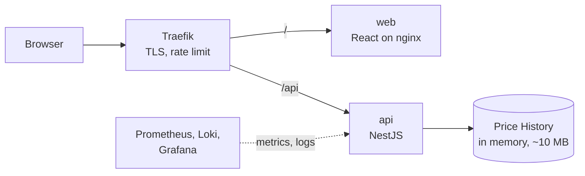

# simple-stock-history

[](https://github.com/stefan-stefanooov/simple-stock-history/actions/workflows/ci.yml)

Finds the **Best Trade** for the fictional Share `ACME`: given a Time Slice of its Price History, when to buy and when to sell for the highest Profit. The Price History has one Price Point per second for all of November 2025 (UTC). The API finds the Best Trade; the web app lets you pick a Time Slice, enter your Available Funds and see the outcome. It runs at `https://stocks.lan` on the homelab.

## How it works



- **Data:** generated from a seed while the api image builds, pinned by sha256, and held in memory. No database. [ADR-0001](docs/adr/0001-price-history-generated-at-build.md)
- **Search:** hour summaries answer any Time Slice, even the whole month, in about 15 µs. [ADR-0002](docs/adr/0002-best-trade-search-uses-hour-summaries.md), [alternatives with measurements](docs/best-trade-alternatives/README.md)
- **API:** `GET /api/v1/period` and `GET /api/v1/trades/best?from=&to=`; errors are RFC 9457 problem+json. [API](docs/api.md)
- **Web:** Time Slice picker to the second (UTC), Available Funds, and the result in whole shares and USD, worked out in the browser.
- **Runs on:** the homelab k3s cluster, deployed by Argo CD, watched in Grafana. [Operations](docs/operations.md)

## Layout

An [Nx](https://nx.dev) workspace with pnpm:

| Path                                                             | What it is                                                                                              |
| ---------------------------------------------------------------- | ------------------------------------------------------------------------------------------------------- |
| [`apps/api`](apps/api)                                           | NestJS API: loads the Price History, serves the Best Trade. Jest tests.                                 |
| [`apps/web`](apps/web)                                           | React + Vite web app, Tailwind CSS. Vitest tests.                                                       |
| [`libs/shared`](libs/shared)                                     | The API contract: zod schemas for validation, types and the OpenAPI document.                           |
| [`libs/best-trade`](libs/best-trade)                             | The Best Trade search over hour summaries, plain TypeScript ([README](libs/best-trade/README.md)).      |
| [`tools/price-history-generator`](tools/price-history-generator) | Generates the Price History and its hour summaries ([README](tools/price-history-generator/README.md)). |

## Quick start

With Node 24 (`nvm use`):

```sh
corepack enable && pnpm install
pnpm nx serve api   # http://localhost:3000, Swagger UI at /api/docs
pnpm nx serve web   # http://localhost:4200
```

Setup details, configuration, tests and container images: [Development](docs/development.md).

## Docs

| Doc                                                                      | Read it for                                                         |
| ------------------------------------------------------------------------ | ------------------------------------------------------------------- |
| [ASSIGNMENT.md](ASSIGNMENT.md)                                           | The assignment this answers                                         |
| [GLOSSARY.md](GLOSSARY.md)                                               | The domain words (Share, Time Slice, Best Trade, ...), used exactly |
| [#2](https://github.com/stefan-stefanooov/simple-stock-history/issues/2) | The agreed design and the issue tree the work follows               |
| [docs/adr](docs/adr)                                                     | The decisions behind the design                                     |
| [Best Trade search alternatives](docs/best-trade-alternatives/README.md) | The options measured against each other, with charts                |
| [Development](docs/development.md)                                       | Setup, running, configuration, tests, CI, container images          |
| [API](docs/api.md)                                                       | Routes, errors, caching, health and metrics endpoints               |
| [Operations](docs/operations.md)                                         | Deploy, rollback, dashboards, logs, alerts, rate limit              |
| [Releasing](docs/releasing.md)                                           | Cutting a release to GHCR                                           |

## Contributing

Work follows the issue tree in [#2](https://github.com/stefan-stefanooov/simple-stock-history/issues/2): one leaf issue, one PR, whose body says `Closes #<n>`. Sign off every commit (`git commit -s`); the DCO check fails a PR with an unsigned commit. More in [CLAUDE.md](CLAUDE.md).
