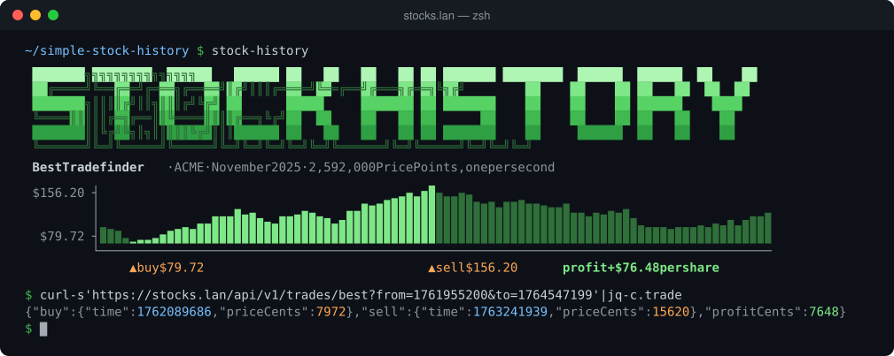
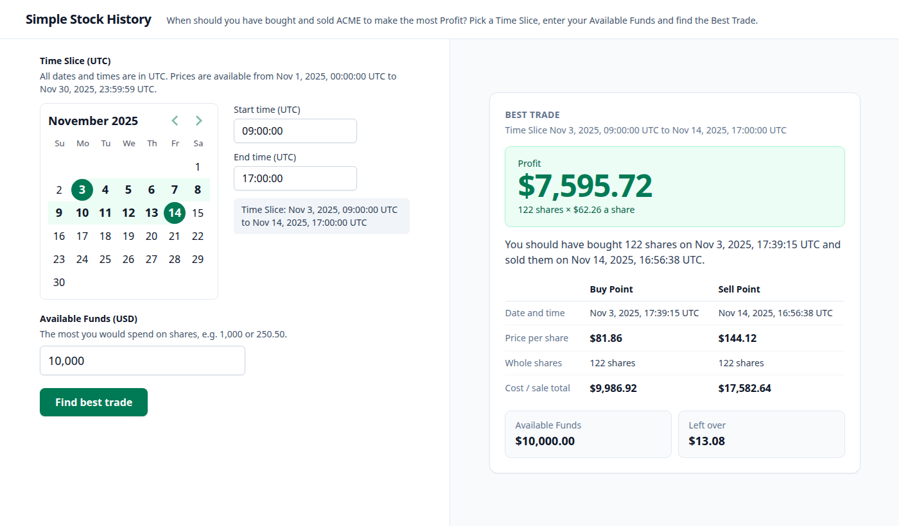

# simple-stock-history

[](https://github.com/stefan-stefanooov/simple-stock-history/actions/workflows/ci.yml)

Finds the **Best Trade** for the fictional Share `ACME`: given a Time Slice of its Price History, when to buy and when to sell for the highest Profit. The Price History has one Price Point per second for all of November 2025 (UTC). The API finds the Best Trade; the web app lets you pick a Time Slice, enter your Available Funds and see the outcome. It runs at `https://stocks.lan` on the homelab.

## Sneak preview



3 to 14 November, 09:00:00 to 17:00:00 UTC, with $10,000: buy 122 shares at $81.86, sell them at $144.12, for a Profit of $7,595.72.

## How it works


- **Data:** generated from a seed while the api image builds, pinned by sha256, and held in memory. No database. [ADR-0001](docs/adr/0001-price-history-generated-at-build.md)
- **Search:** hour summaries answer any Time Slice, even the whole month, in about 15 µs. [how it works](docs/best-trade-search.md), [ADR-0002](docs/adr/0002-best-trade-search-uses-hour-summaries.md), [alternatives with measurements](docs/best-trade-alternatives/README.md)
- **API:** `GET /api/v1/period` and `GET /api/v1/trades/best?from=&to=`; errors are RFC 9457 problem+json. [API](docs/api.md)
- **Web:** Time Slice picker to the second (UTC), Available Funds, and the result in whole shares and USD, worked out in the browser.
- **Runs on:** the homelab k3s cluster, deployed by Argo CD, watched in Grafana. [Operations](docs/operations.md)

## Observability

Everything is in Grafana (`https://grafana.lan`) on the homelab. Dashboard, alerts and scrape config live in the [homelab repo](https://github.com/stefan-stefanooov/homelab/tree/main/workloads/stock-history).

- **Metrics:** the api serves Prometheus metrics at `/metrics`, inside the cluster only: requests and latency by route and status, Best Trade search time, Time Slice length, and Node.js process metrics. [Metrics](docs/api.md#metrics)
- **Errors:** counted by status code. The 5xx ratio has a panel and an alert; 4xx show per route and status; 429s from the rate limit are counted by Traefik.
- **Dashboard:** request rate, p95 latency, 5xx ratio, search time, Time Slice length, 429s, restarts, CPU and memory against limits, and the api's logs. [Operations](docs/operations.md#dashboards-logs-and-alerts)
- **Alerts:** api down, more than 5% 5xx, p95 above 500 ms; tested with promtool. No notification channel yet.
- **Logs:** one JSON line per request (pino), `warn` for 4xx and `error` for 5xx, shipped to Loki by Alloy and kept 7 days. [Logs](docs/api.md#logs)

## Layout

An [Nx](https://nx.dev) workspace with pnpm:

| Path                                                             | What it is                                                                                              |
| ---------------------------------------------------------------- | ------------------------------------------------------------------------------------------------------- |
| [`apps/api`](apps/api)                                           | NestJS API: loads the Price History, serves the Best Trade. Jest tests.                                 |
| [`apps/web`](apps/web)                                           | React + Vite web app, Tailwind CSS. Vitest tests.                                                       |
| [`libs/shared`](libs/shared)                                     | The API contract: zod schemas for validation, types and the OpenAPI document.                           |
| [`libs/best-trade`](libs/best-trade)                             | The Best Trade search over hour summaries, plain TypeScript ([README](libs/best-trade/README.md)).      |
| [`tools/price-history-generator`](tools/price-history-generator) | Generates the Price History and its hour summaries ([README](tools/price-history-generator/README.md)). |

## Quick start

With Node 24 (`nvm use`):

```sh
corepack enable && pnpm install
pnpm nx serve api   # http://localhost:3000, Swagger UI at /api/docs
pnpm nx serve web   # http://localhost:4200
```

Setup details, configuration, tests and container images: [Development](docs/development.md).

## Docs

### Assignment and design

| Doc                                                                                                       | Read it for                                                                                                                                                                   |
| --------------------------------------------------------------------------------------------------------- | ----------------------------------------------------------------------------------------------------------------------------------------------------------------------------- |
| [ASSIGNMENT.md](ASSIGNMENT.md)                                                                            | The assignment this answers                                                                                                                                                   |
| [GLOSSARY.md](GLOSSARY.md)                                                                                | The domain words (Share, Time Slice, Best Trade, ...), used exactly                                                                                                           |
| [#2 Build Simple Stock History](https://github.com/stefan-stefanooov/simple-stock-history/issues/2)       | The main issue: the agreed design (domain, data, API, web UI, deployment and monitoring). Its sub-issues are the epics, and each epic's sub-issues are the tasks, one PR each |
| [ADR-0001: Price History generated at build](docs/adr/0001-price-history-generated-at-build.md)           | Why the data is generated from a seed in the image build, pinned by sha256, with no database                                                                                  |
| [ADR-0002: Best Trade search uses hour summaries](docs/adr/0002-best-trade-search-uses-hour-summaries.md) | Why the search uses hour summaries, and the options that were rejected                                                                                                        |
| [How the Best Trade search works](docs/best-trade-search.md)                                              | The algorithm step by step, with a worked example                                                                                                                             |
| [Best Trade search alternatives](docs/best-trade-alternatives/README.md)                                  | The options measured against each other, with charts                                                                                                                          |
| [API](docs/api.md)                                                                                        | Routes, errors, caching, health endpoints, the metrics and logs it exports                                                                                                    |

### Development and deployment

| Doc                                | Read it for                                                |
| ---------------------------------- | ---------------------------------------------------------- |
| [Development](docs/development.md) | Setup, running, configuration, tests, CI, container images |
| [Releasing](docs/releasing.md)     | Cutting a release to GHCR                                  |
| [Operations](docs/operations.md)   | Deploy, rollback, dashboards, logs, alerts, rate limit     |

### For coding agents

| Doc                                           | Read it for                                                                  |
| --------------------------------------------- | ---------------------------------------------------------------------------- |
| [CLAUDE.md](CLAUDE.md)                        | How to work an issue, commit sign-off, where the agent docs are              |
| [Issue tracker](docs/agents/issue-tracker.md) | Working with GitHub issues via `gh`: conventions, reading an issue's context |
| [Triage labels](docs/agents/triage-labels.md) | The triage roles mapped to this repo's labels                                |
| [Domain docs](docs/agents/domain.md)          | Which domain docs (glossary, ADRs) to read before exploring the code         |

## Contributing

Work follows the issue tree in [#2](https://github.com/stefan-stefanooov/simple-stock-history/issues/2): one leaf issue, one PR, whose body says `Closes #<n>`. Sign off every commit (`git commit -s`); the DCO check fails a PR with an unsigned commit. More in [CLAUDE.md](CLAUDE.md).
