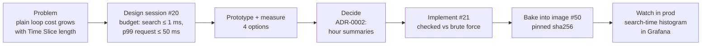
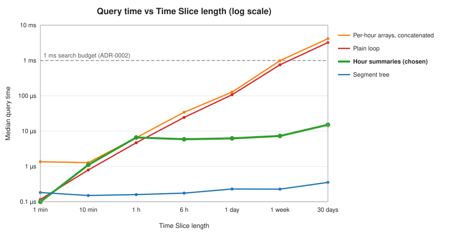
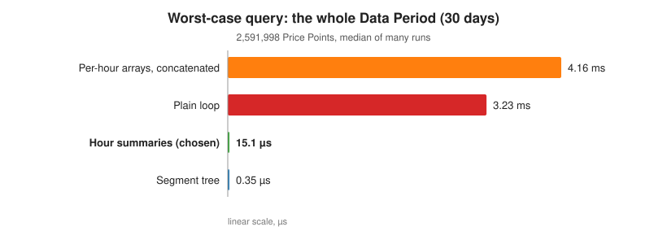
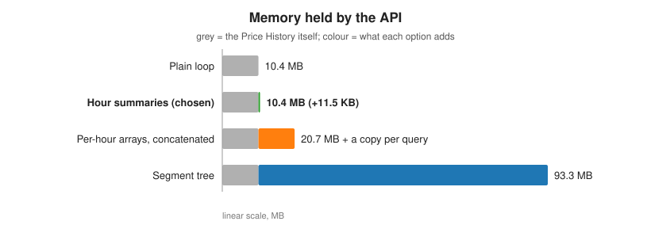
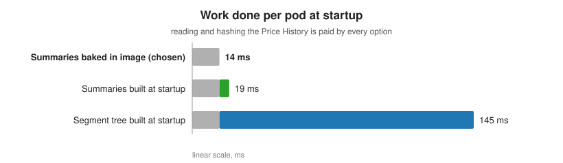
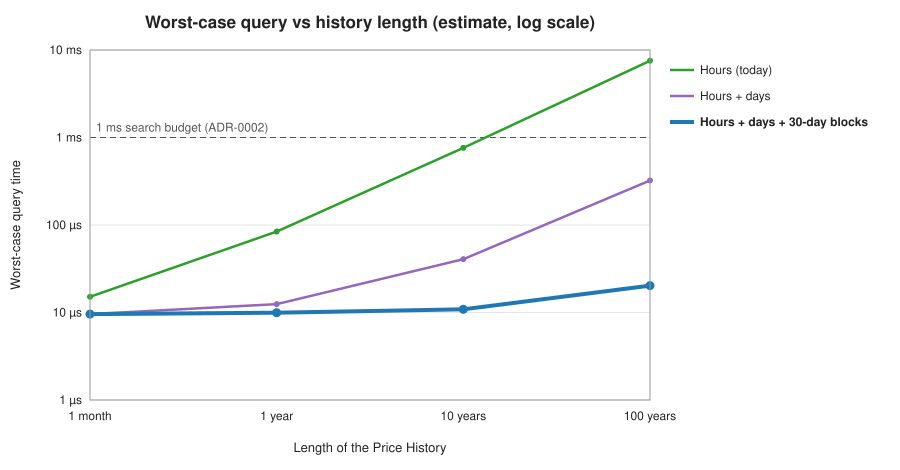
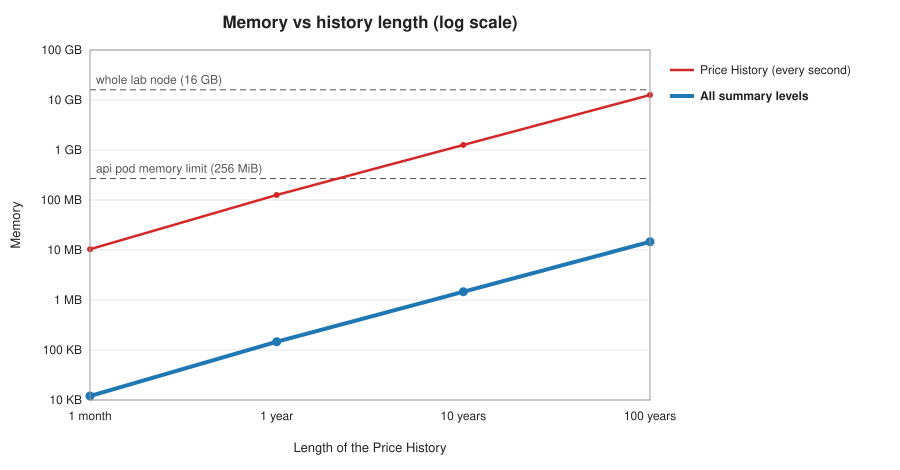

# Best Trade search: alternatives considered and rejected

Goal: a query for any Time Slice of the 2,592,000 Price Points should be fast, give the exact tie-break (highest Profit → earliest Buy Point → earliest Sell Point), and need no limit on Time Slice length. The decision is [ADR-0002](../adr/0002-best-trade-search-uses-hour-summaries.md).

## The process



1. **Problem:** the obvious one-pass loop reads every Price Point in the Time Slice, so a whole-month query costs milliseconds per request, and longer Time Slices cost more.
2. **Budget first** (#20): the search takes at most 1 ms for any Time Slice, and 99% of requests take at most 50 ms server-side on the lab node.
3. **Prototype and measure** the options below on the real Price History.
4. **Decide and record:** hour summaries, written up in ADR-0002 with the rejected options.
5. **Implement** in `libs/best-trade` (#21), with every result checked against a brute-force O(n²) reference. The prototype took about 0.4 ms for the worst case; the implementation takes about 0.015–0.04 ms, depending on the machine.
6. **Build once per release** (#50): the generator writes the summaries at image build, pinned by sha256 like the Price History.
7. **Verify in production:** the `best_trade_search_duration_seconds` histogram is on the Grafana dashboard. Its buckets reach 10 ms, so a regression to the plain loop would show.

## The options

| Option                               | Idea                                                                                                                      |
| ------------------------------------ | ------------------------------------------------------------------------------------------------------------------------- |
| **Plain loop**                       | One pass over the Time Slice, tracking the earliest lowest price.                                                         |
| **Hour summaries** (chosen)          | Each hour stores 4 numbers: lowest, highest, its own Best Trade. A query loops over ≤ 2 partial hours and joins the rest. |
| **Segment tree** (to single seconds) | Summaries of the same kind in a binary tree over every second, so a query joins O(log n) nodes.                           |
| **Per-hour arrays, concatenated**    | The Price History stored as one array per hour; a query copies the hours it needs into one array, then loops.             |
| **Summaries built at startup**       | Same as the chosen option, but each pod computes them instead of reading them from the image.                             |

## Query time



- The **plain loop** and the **concatenated arrays** grow linearly with the Time Slice. The concatenated arrays are slower at every length: they copy the same Price Points before looping over them.
- **Hour summaries** stop growing at one hour: past that point, a query loops over two partial hours at most and joins the rest from summaries. Up to one hour they are the same loop, slightly slower because they also track the highest price.
- The **segment tree** is the fastest everywhere.



## Memory and startup





## Verdict

| Option                        | Whole month | Memory       | Verdict                                                                                                                                                                                         |
| ----------------------------- | ----------- | ------------ | ----------------------------------------------------------------------------------------------------------------------------------------------------------------------------------------------- |
| Plain loop                    | 3.23 ms     | 10.4 MB      | ❌ Simplest, but cost grows with the Time Slice: it's an easy lever for slow requests. It survives inside the partial hours.                                                                    |
| **Hour summaries**            | **15.1 µs** | **+11.5 KB** | ✅ **Chosen.** ~210× faster than the plain loop on the worst case, flat after one hour, almost no extra memory. No Time Slice limit needed.                                                     |
| Segment tree                  | 0.35 µs     | +83 MB       | ❌ ~43× faster than the chosen option, but both are far below what a user can notice (HTTP overhead is milliseconds). Costs 8× the data's memory on a 16 GB node, plus 131 ms to build per pod. |
| Per-hour arrays, concatenated | 4.16 ms     | +10.4 MB     | ❌ Slower than the plain loop at every length, and doubles memory.                                                                                                                              |
| Summaries built at startup    | 15.1 µs     | +11.5 KB     | ❌ Only +5 ms per pod, but the data is static: the summaries belong to the release like the Price History, built once and pinned by sha256.                                                     |

**In one sentence:** the segment tree wins on raw speed, but hour summaries are already ~210× faster than the plain loop and well inside the budget, at 0.1% extra memory, so the last 15 µs aren't worth 83 MB.

## Scaling to a huge history: stack the summaries

Today the Data Period is one month: 720 hour summaries. A query joins every whole hour in its Time Slice, so its cost grows with the length of the history: a 100-year history would mean 876,000 joins and about 7.5 ms per query, over the budget.

The fix is the same join one level up. The join works on **any two adjacent pieces, whatever their size**, so summaries can summarize summaries:

```text
Price Points  ──3,600──▶  hour summary  ──24──▶  day summary  ──30──▶  30-day block summary
```

Each level is built once, at image build, by joining the level below, and is pinned by sha256 like the hour summaries. The blocks have a fixed length (30 days, not calendar months), so finding the block of a second is still a single division.

A query walks **up** the left edge, **across** the top and **down** the right edge, joining in time order:

```text
Time Slice      |◀─────────────────────────────────────────────────────────▶|
30-day blocks                  [  block  ][  block  ][  block  ]
days                  [d][d][d]                                 [d][d]
hours           [h][h]                                                [h][h]
Price Points  ::                                                            ::
```

| Level                  | Per query, worst case                  |
| ---------------------- | -------------------------------------- |
| Price Points           | ≤ 3,599 at each end (the partial hour) |
| Hour summaries         | ≤ 23 at each end (the partial day)     |
| Day summaries          | ≤ 29 at each end (the partial block)   |
| 30-day block summaries | every whole block in between           |

Every level but the top costs a fixed amount, however long the history is; only the top level grows. Adding a level whenever the top one gets long keeps the worst case almost flat:



| History   | Hours (today)             | Hours + days          | Hours + days + 30-day blocks |
| --------- | ------------------------- | --------------------- | ---------------------------- |
| 1 month   | 718 joins, 15 µs          | 74 joins, 10 µs       | (no whole block)             |
| 1 year    | 8,758 joins, 84 µs        | 409 joins, 13 µs      | 115 joins, 10 µs             |
| 10 years  | 87,598 joins, 0.76 ms     | 3,694 joins, 41 µs    | 224 joins, 11 µs             |
| 100 years | 875,998 joins, **7.5 ms** | 36,544 joins, 0.32 ms | 1,319 joins, **20 µs**       |

### Memory becomes the limit first



The Price History costs 4 bytes a second: past about two years it no longer fits the api pod's 256 MiB, and at 100 years (12.6 GB) it barely fits the whole node. All summary levels together stay tiny: 14.6 MB at 100 years.

So at that scale:

- **Keep every summary level in memory**, and the Price Points **on disk**.
- **Read only the two partial hours per query**: two reads of at most 14.4 KB, at a known offset (position × 4 bytes) in the same Int32 file.
- To shrink those reads further, add a **minute level** under the hours: then at most 59 Price Points are read at each end. Minute summaries for 100 years take about 840 MB, though, so they would live on disk as well.

The segment tree is this idea taken to the extreme: a level for every factor of 2, starting from single seconds. That is why it needs 8× the data's memory. Large steps between levels (3,600, 24, 30) keep the summaries about 0.1% of the data's size.

The times above are estimates, not measurements: they use the measured cost of about 1.24 ns per Price Point looped over and 8.6 ns per join, and leave out disk reads.

## How this was measured

- Measured once, on 2 November 2026, on the real Price History: Node 24.21, Intel Core Ultra 5 325. Times are medians of many runs after warm-up.
- Each Time Slice starts at position 1, so the first hour is partial, as in the worst case. "30 days" is positions 1 to 2,591,998: two almost-whole partial hours plus 718 summaries.
- All four searches returned the same Best Trade for every Time Slice before they were timed.
- The ADR's numbers come from an older dev machine (plain loop 6–10 ms, chosen option ~0.035 ms, segment tree ~1 µs). The ratios are similar; the lab node is slower than both.
